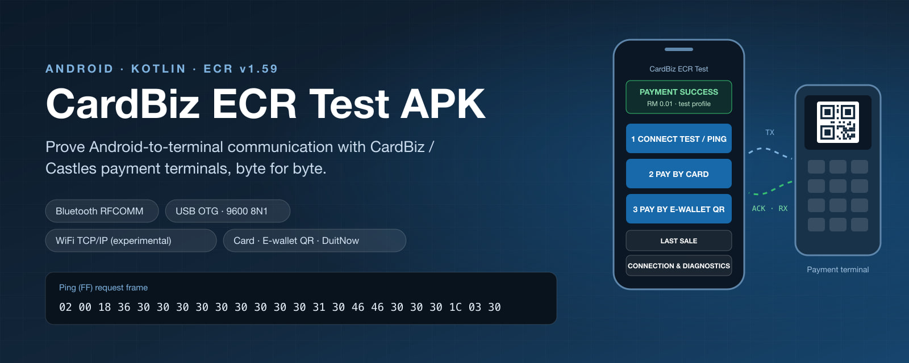
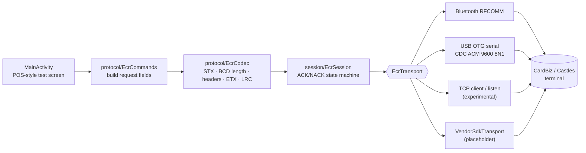
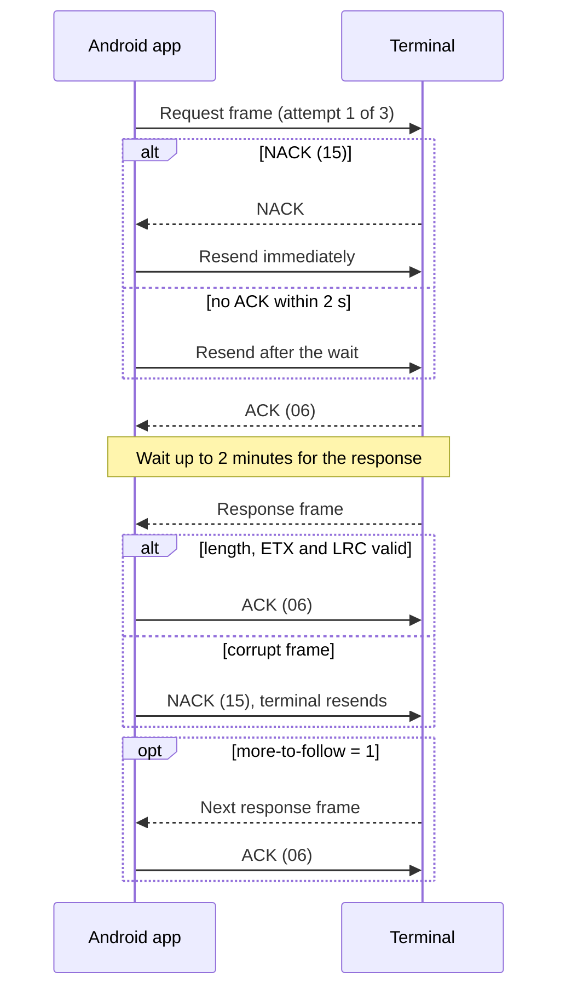
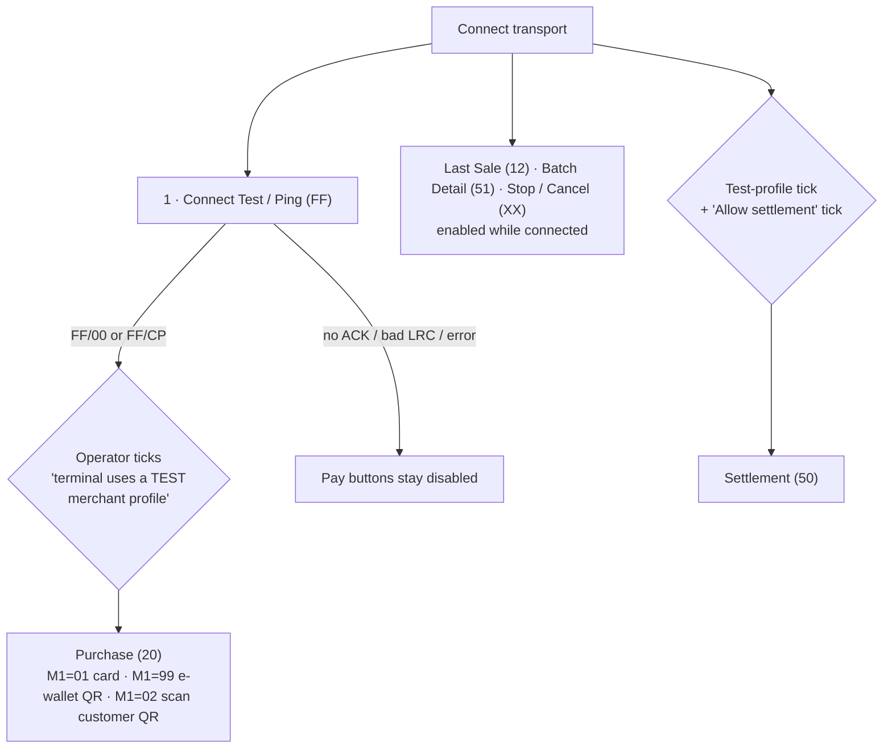
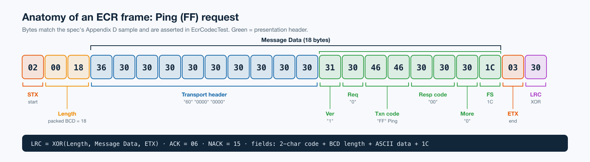

# CardBiz ECR Test APK

**A native Kotlin Android test app that proves an Android device can talk to a CardBiz/Castles payment terminal over ECR.** It has a POS-style test screen and implements the byte-level protocol from **CardBiz ECR Integration Functional Specs v1.59 (2026-06-15)**.




<sub>Illustration. The button labels and the Ping frame come from the app's source and unit tests.</sub>

The app deliberately leaves out production checkout, receipts and credential storage. It is a diagnostic harness for a terminal on a **test merchant profile**.

## Contents

- [Safety](#safety)
- [How it works](#how-it-works)
- [What is implemented](#what-is-implemented)
- [Build](#build)
- [First terminal test](#first-terminal-test)
- [Configuration](#configuration)
- [Transport limitations](#transport-limitations)
- [What CardBiz/Castles must provide](#what-cardbizcastles-must-provide)
- [Adding a vendor AAR](#adding-a-vendor-aar)
- [Source layout](#source-layout)
- [Troubleshooting](#troubleshooting)
- [Known scope boundaries](#known-scope-boundaries)

## Safety

Use only a CardBiz/Castles terminal configured with a test merchant profile.

- Ping (`FF`) is the first connection test when no Pay Account ID is available.
- Purchase stays locked until two things happen: Ping returns a valid `FF/00` or `FF/CP` response, and the operator confirms test mode. Different terminal firmware returns one or the other.
- Test Purchase offers three routes, chosen by Merchant Index:
  - `M1=01`: card.
  - `M1=99`: e-wallet QR. The terminal displays a DuitNow QR for the customer's e-wallet to scan.
  - `M1=02`: scan customer QR. The terminal camera reads the customer's wallet barcode.

  All three routes share the same Ping and test-mode gate.
- A Purchase counts as successful only when the terminal response validates with response indicator `1`, transaction code `20` and response code `00`. The main screen then shows `PAYMENT SUCCESS` with the amount and any receipt references. Raw data stays in diagnostics.
- Settlement changes the terminal's batch state. It needs the test-mode confirmation plus its own separate Settlement confirmation.
- Never enter production merchant secrets. The app does not ship with any Pay Account ID.
- Raw protocol data is shown on screen and mirrored to Logcat for diagnostics. Never collect logs from production transactions.

## How it works



Each command runs through the same send/acknowledge cycle (`EcrSession`):



Payments and settlement are gated behind confirmations:



Every request and response is an ECR frame:



Purchase amounts are converted to a 12-digit implied-decimal field: `0.01` becomes `000000000001` and `1.00` becomes `000000000100`. More protocol detail is in [`PROTOCOL_NOTES.md`](PROTOCOL_NOTES.md).

## What is implemented

**Transports**

- Bluetooth: lists paired devices and runs discovery, and connects over Bluetooth Classic RFCOMM with an editable service UUID.
- USB/OTG: detected automatically. The app shows Android's USB permission prompt, reconnects when the cable is plugged back in, configures CDC ACM at 9600/8N1 and uses bulk I/O.
- WiFi (TCP/IP): a first-class connection method next to Cable on the main screen. Enter the terminal's IP and port, or tick the listen option so the terminal connects to this device's IP instead. Settings persist across restarts. The spec defines no TCP transport, so this works only after CardBiz enables ECR over TCP/IP on the terminal and supplies the IP, port and direction.

**Commands**

| Command | Code | Request fields |
|---|---:|---|
| Ping | `FF` | none |
| Verify Pay Account ID | `00` | `00` Pay Account ID (20) |
| Last Transaction Inquiry | `12` | `00` Pay Account ID (20), `66` Transaction ID (20) |
| Purchase | `20` | optional `00`, `66`, `40` amount, `M1` = `01` card / `02` scan customer QR / `99` e-wallet (DuitNow) QR |
| Settlement | `50` | `00`, `66`, `52` force flag (`0` in this app) |
| Get Batch Detail | `51` | `00`, `66` |
| Cancel Transaction | `XX` | `00`, `66` |

**Payment routes**

| Button | Merchant Index | What the terminal does | Extra response data |
|---|---|---|---|
| **2 · Pay by Card** | `M1=01` | Goes straight to its tap/insert-card screen | card type (`D4`, falling back to issuer `D2`), last four digits (`30`), entry mode (`E6`) |
| **3 · Pay by E-wallet QR** | `M1=99` | Displays a DuitNow QR for the customer's e-wallet (TNG, Boost, GrabPay or a banking app) to scan | DuitNow tags `N8` / `N4` / `N5` bill number / `N6` PayNet Biz Msg ID |
| Alt: scan customer QR | `M1=02` | Opens its camera and reads the QR or barcode in the customer's wallet app | entry mode `60`, wallet custom data in field `99` (e.g. `B910` = `TNG WALLET`) |

**Screen and diagnostics**

- Simple POS-style buttons: Ping, Pay by Card, Pay by E-wallet QR and Last Sale, plus a secondary scan-customer-QR option. Connection settings and raw logs live under **Connection & Diagnostics**.
- Connect/disconnect state, raw TX/RX hex, ACK/NACK events and parsed response fields.
- Payment results record RRN, batch, terminal ID, merchant number and terminal date/time. The terminal never returns a CVV, and the app never collects one.
- The app never prints receipts and sends no receipt flag, because v1.59 has no receipt control in Purchase. Whether the terminal prints a receipt (for example, not at all on a kiosk) is set by CardBiz in the terminal's ECR profile.
- Wallet custom data in field `99` (tag/length/value, e.g. `B910` wallet product name) is parsed and shown in the payment result.

**Protocol engine**

- Packed-BCD lengths and STX/ETX/LRC framing.
- 2-second ACK timeout with up to three sends in total.
- 2-minute response timeout.
- ACK/NACK of each response, and multi-message responses.

**Tests**

- Unit tests check the PDF's Verify ID, Ping, card Purchase, wallet Purchase and DuitNow QR Purchase sample frames byte for byte. They also cover wallet and DuitNow response decoding and the ACK/NACK session flow.

## Build

Requirements:

- Android Studio with JDK 17, or JDK 17 plus the Android command-line SDK.
- Android SDK Platform 35 and Build Tools 35.0.0.

The app targets SDK 35 and runs on Android 8.0 (API 26) and later. It uses AGP 8.9.2, Kotlin 2.1.20 and the Gradle 8.11.1 wrapper.

Open this directory in Android Studio and select **Build > Build APK(s)**, or run:

```bash
./gradlew testDebugUnitTest assembleDebug
```

The debug APK is generated at:

```text
app/build/outputs/apk/debug/app-debug.apk
```

A versioned copy from the verified build is also placed at:

```text
output/apk/CardBiz-ECR-Test-0.5.0-debug.apk
```

Install on a connected test device with:

```bash
adb install -r app/build/outputs/apk/debug/app-debug.apk
```

## First terminal test

1. Confirm with CardBiz that the terminal is on a test merchant profile and ECR mode is enabled.
2. If you're using Bluetooth, pair the Android device and the terminal in Android Settings.
3. For USB/OTG, plug in the terminal and approve Android's USB prompt once. The app connects automatically, disconnects when you unplug, and reconnects when you plug back in.
4. For Bluetooth, open **Connection & Diagnostics**, grant the Nearby Devices permission, select the paired terminal and tap **Connect**.
5. Bluetooth defaults to SPP UUID `00001101-0000-1000-8000-00805F9B34FB`. Replace it if CardBiz supplies a different RFCOMM UUID.
6. Tap **Connect Test / Ping** and confirm `RX ACK`, a valid LRC and an `FF/00` or `FF/CP` response.
7. Tick the test-profile confirmation and tap **Pay by Card** with a low value such as `0.01`. The app sends `M1=01`, so the terminal goes directly to its tap/insert-card screen.
8. To test e-wallet QR, tap **Pay by E-wallet QR**. The app sends `M1=99`, and the terminal displays a DuitNow QR that the customer scans with TNG, Boost, GrabPay or a banking app. A successful response carries the `N5` bill number and `N6` PayNet Biz Msg ID.
9. The smaller alternative button sends `M1=02`. The terminal opens its camera and reads the QR or barcode shown in the customer's wallet app. A successful response carries card entry mode `60` and wallet custom data in field `99` (for example `B910` = `TNG WALLET`).

## Configuration

The app has no environment variables, build-time secrets or config files. Everything is entered on the device at run time:

| Setting | Where | Notes |
|---|---|---|
| Connection method | Main screen: **Cable (USB / RS232)** or **WiFi (TCP/IP)** | Choice persists across restarts |
| Terminal IP / port, listen mode | Main screen (WiFi) | Persist across restarts |
| Bluetooth device and RFCOMM UUID | **Connection & Diagnostics** | Defaults to the SPP UUID |
| Pay Account ID | Main screen | Optional for Purchase. Required (20 characters) for Verify ID, Last Transaction Inquiry, Batch Detail and Settlement |
| Transaction ID | Main screen (**New** generates one) | 20 characters |
| Amount | Main screen | Converted to a 12-digit implied-decimal field |

Pay Account ID is optional for Purchase. Leave it blank when CardBiz has only supplied a MID/TID, and never put the MID or TID in that field.

Android Studio writes `local.properties` (the `sdk.dir` path). That file is git-ignored. Keep any CardBiz-supplied credentials out of Git as well.

Logcat tag: `CardBizEcrTest`.

## Transport limitations

### Bluetooth

Appendix E gives the protocol/service name:

```text
com.castles.protocolCastles
```

That is not an Android RFCOMM UUID. Android needs the terminal's SDP UUID/channel, or a vendor SDK that resolves the service. So the app makes the UUID editable and starts with the common Serial Port Profile UUID. A failure with the default UUID doesn't prove the ECR protocol is incompatible. It means the Bluetooth transport parameters still need confirming.

### USB

Appendix F defines RS232 as 9600 bps, no parity, 8 data bits, 1 stop bit, retries 3. This app applies 9600/8N1 to CDC ACM USB devices and uses bulk endpoints. CH340, CP210x, FTDI, Prolific or proprietary Castles interfaces may need a chipset driver or the vendor AAR. Use a data-capable OTG cable. Also confirm whether the terminal is DCE or DTE, and whether a USB-to-RS232 bridge needs a null-modem adapter.

### TCP/IP

The v1.59 PDF does not define TCP/IP, a port, the terminal's client/server role or TLS. TCP mode is included only as an experimental direct byte stream. Don't assume it is supported until CardBiz provides the endpoint and confirms that the same ECR frame is carried without an extra transport envelope.

## What CardBiz/Castles must provide

Ask for:

1. The Android integration package: AAR/JAR, Maven coordinates if any, API documentation, a sample application and the supported Android/API/ABI versions.
2. License/activation requirements and a test merchant profile/Pay Account ID. Keep supplied credentials out of Git.
3. The Bluetooth pairing workflow, the SDP service UUID or RFCOMM channel, and confirmation of how `com.castles.protocolCastles` maps to Android.
4. Supported terminal models and firmware versions, plus the menu/configuration needed to enable external-device ECR.
5. The USB VID/PID list, interface type and driver requirements, and the exact cable/bridge wiring.
6. If TCP ECR is supported: the server/client role, port, IP setup, framing, TLS and keepalive rules.
7. Expected behavior for duplicate transaction IDs, timeout/reversal recovery and settlement in test mode, plus the certification test cases.

## Adding a vendor AAR

Place the supplied file at `app/libs/cardbiz-ecr-sdk.aar`, then add this dependency to `app/build.gradle.kts`:

```kotlin
dependencies {
    implementation(files("libs/cardbiz-ecr-sdk.aar"))
    testImplementation("junit:junit:4.13.2")
}
```

Implement the methods in `app/src/main/java/com/cardbiz/ecrtest/transport/VendorSdkTransport.kt`, mapping the SDK's connection and byte/callback APIs to `EcrTransport` (`connect`, `disconnect`, `write`, `read(timeoutMs)`). If the SDK builds ECR messages itself, keep the raw codec unit tests as an independent reference and document which layer owns ACK/NACK handling.

## Source layout

```text
app/src/main/java/com/cardbiz/ecrtest/
  MainActivity.kt                 test UI and Android permissions
  protocol/                       frame/command codec (Bcd, EcrCodec, EcrCommands)
  session/                        ACK/NACK transaction state machine, stream decoder
  transport/                      Bluetooth, USB, TCP client, TCP listen and SDK seam
app/src/main/res/xml/device_filter.xml   accepts any USB device (bulk serial checked in code)
app/src/test/                     protocol sample-vector and session tests
output/apk/                       versioned debug APKs from verified builds
PRODUCT_STRUCTURE.md              scope and safety boundaries
PROTOCOL_NOTES.md                 implementation mapping to v1.59
```

## Troubleshooting

| Symptom | What it means / what to do |
|---|---|
| Ping gets no `RX ACK` over Bluetooth | The default SPP UUID may be wrong for this terminal. Ask CardBiz for the RFCOMM UUID/channel (see [Bluetooth](#bluetooth)). |
| USB device is detected but nothing is received | The bridge chipset may need a driver or the vendor AAR, or the cable isn't data-capable. Check DCE/DTE and null-modem wiring (see [USB](#usb)). |
| Response code `TE` or a merchant-selection error on a wallet or DuitNow request | That merchant index isn't configured on the terminal profile. Ask CardBiz to enable the wallet/DuitNow merchant on the test terminal. The app-side framing matches the v1.59 samples byte for byte. |
| Verify ID, Last Sale, Batch Detail or Settlement rejects the input | These commands need the 20-character Pay Account ID. Purchase doesn't. |
| `Terminal did not ACK after 3 sends` | The frame reached the wrong endpoint or the transport parameters are wrong. Check the raw TX hex and Logcat (`CardBizEcrTest`). |
| `No response within 2 minutes after ACK` | The terminal accepted the request but didn't finish it (for example, the customer never tapped or scanned). Use **Last Sale** to inspect the latest transaction. |
| WiFi mode can't connect | TCP isn't part of v1.59. CardBiz must enable ECR over TCP/IP and confirm the IP, port and which side listens. |

## Known scope boundaries

- Test harness only. It is not certified as a POS integration.
- No automatic reversal or duplicate-suppression ledger.
- No receipt rendering, PAN storage, PIN capture or production key management.
- Raw USB support is intentionally generic and may need a driver for the actual bridge chipset.
- No assumptions are made about TCP support beyond a simple socket.
